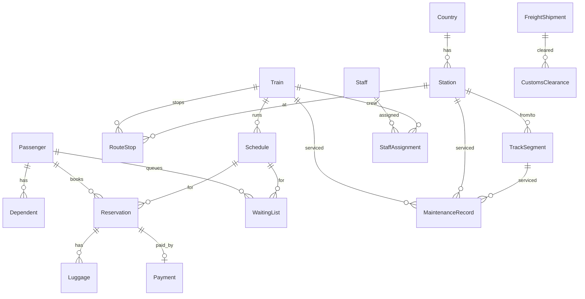

# 🚆 Railway Corridor — Veritabanı Projesi

Suudi Arabistan → Ürdün → Suriye → Türkiye hattını kapsayan **çok ülkeli bir demiryolu koridoru** için tasarlanmış ilişkisel veritabanı (MySQL). Yolcu taşımacılığı, yük/kargo, gümrük, personel ve bakım süreçlerini tek şemada modeller.

## 📁 Dosyalar
| Dosya | Açıklama |
|---|---|
| `create_database.sql` | `railway_corridor` veritabanını sıfırdan oluşturur (`DROP DATABASE IF EXISTS` + 17 tablo) |
| `insert_database.sql` | Her tabloya örnek veri ekler (önce `TRUNCATE` ile temizler) |
| `query_database.sql` | 10 adet örnek rapor sorgusu |

## 🧱 Veri Modeli (17 tablo)
| Alan | Tablolar |
|---|---|
| Altyapı | `Country`, `Station`, `TrackSegment` |
| Seferler | `Train`, `RouteStop`, `Schedule` |
| Yolcu işlemleri | `Passenger`, `Dependent`, `Reservation`, `Luggage`, `Payment`, `WaitingList` |
| Personel | `Staff`, `StaffAssignment` |
| Yük & gümrük | `FreightShipment`, `CustomsClearance` |
| Bakım | `MaintenanceRecord` |



## ✅ Veritabanı seviyesinde uygulanan iş kuralları
- **Koltuk çakışması yok:** `UNIQUE (schedule_id, seat_number)`
- **Personel aynı gün iki trende çalışamaz:** `UNIQUE (staff_id, travel_date)`
- **Bir rezervasyon = bir ödeme:** `Payment.reservation_id` UNIQUE
- **Bir trenin durak sırası ve durağı tekrar edemez:** `UNIQUE (train_id, stop_sequence)` / `(train_id, station_id)`
- **Geçerlilik kontrolleri (CHECK):** durum/tip alanları için sabit değer listeleri, mesafe/fiyat/ağırlık > 0, `station_from <> station_to`, bakım kaydında en az bir hedef (tren / istasyon / hat)
- **Sadakat sınıfı:** none / green / silver / gold (`Passenger.loyalty_class`)
- **Bağımlı yolcu indirimi:** %25 (örnek veride 300 → 225)
- **Bekleme listesi:** koltuk dolunca `WaitingList` kaydı, `position` ile sıralama
- **Sınır ötesi kargo → gümrük kaydı:** `CustomsClearance` tablosu ile takip

## 📊 Örnek veri
4 ülke, 6 istasyon, 4 hat parçası, 3 tren (yolcu / yük / karma), 3 sefer, 4 yolcu, 2 bağımlı, 4 rezervasyon, 3 ödeme, 2 bekleme kaydı, 3 personel, 2 kargo, 2 gümrük kaydı, 3 bakım kaydı.

## 🔍 Sorgular (`query_database.sql`)
1. Seçilen tarihte aktif seferler
2. Trenin güzergah sırası (ülke bilgisiyle)
3. Yolcunun rezervasyon detayları
4. Bekleme listesi (sefer ve sıraya göre)
5. Doluluk oranı
6. Bağımlı yolcular
7. Ülke sınırını geçen kargolar
8. Gönderi gümrük durumu
9. Tren bakım geçmişi
10. Tarihe göre personel atamaları

## ▶️ Kurulum
Gereksinim: **MySQL 8.0.16+** (`CHECK` kısıtları için).
```bash
mysql -u root -p < create_database.sql
mysql -u root -p < insert_database.sql
mysql -u root -p < query_database.sql
```

## ⚠️ Bilinen notlar / geliştirme fikirleri
- `query_database.sql` içindeki bazı sorgular (1, 5, 6, 10) **2025** tarihlerini kullanıyor, örnek veri ise **2026** → bu sorgular boş dönebilir; tarihlerin güncellenmesi gerekir.
- Örnek veride şifreler düz metin (`hash1` vb.); gerçek kullanımda bcrypt/argon2 hash'i gerekir.
- Bekleme listesinde loyalty önceliği otomatik değil, `position` elle veriliyor.
- Gümrük kuralı (sınır ötesi kargo ≥ 1 kayıt), bağımlı indirimi ve koltuk sayısı limiti şu an veritabanında zorlanmıyor; trigger / stored procedure ile eklenebilir.
- Performans için ek `INDEX` ve raporlar için `VIEW` tanımlanmamış.