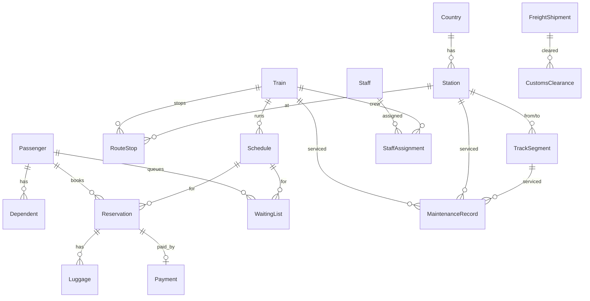

# 🚆 Railway Corridor — Veritabanı ve Rezervasyon Uygulaması

> **EN:** A relational database (MySQL) and Streamlit app modeling a multi-country railway corridor (Saudi Arabia → Jordan → Syria → Türkiye): passenger booking, freight, customs, staff and maintenance.

Suudi Arabistan → Ürdün → Suriye → Türkiye hattını kapsayan **çok ülkeli bir demiryolu koridoru** için tasarlanmış ilişkisel veritabanı (MySQL) ve bu veritabanını kullanan Streamlit arayüzü. Yolcu taşımacılığı, yük/kargo, gümrük, personel ve bakım süreçlerini tek şemada modeller.

**Teknolojiler:** MySQL 8 · Python · Streamlit · pandas · mysql-connector-python

## 📁 Proje Yapısı
| Dosya | Açıklama |
|---|---|
| `create_database.sql` | `railway_corridor` veritabanını ve 17 tabloyu oluşturur (`DROP DATABASE IF EXISTS` + `CREATE`) |
| `insert_database.sql` | Her tabloya örnek veri ekler (önce `TRUNCATE` ile temizler) |
| `query_database.sql` | 10 adet örnek rapor sorgusu |
| `app.py` | Streamlit arayüzü (giriş, kayıt, rezervasyon, bakım kaydı) |
| `requirements.txt` | Python bağımlılıkları |
| `.streamlit/config.toml` | Arayüz teması |

## ▶️ Kurulum ve Çalıştırma
Gereksinimler: **MySQL 8.0.16+** (`CHECK` kısıtları için) ve **Python 3.9+**

**1. Veritabanını kur**
```bash
mysql -u root -p < create_database.sql
mysql -u root -p < insert_database.sql
mysql -u root -p < query_database.sql   # örnek sorgular (isteğe bağlı)
```

**2. Uygulamayı çalıştır**
```powershell
pip install -r requirements.txt
$env:DB_PASSWORD="mysql_sifren"      # Linux/macOS: export DB_PASSWORD=...
streamlit run app.py
```
Bağlantı bilgileri ortam değişkenlerinden okunur: `DB_HOST` (varsayılan `localhost`), `DB_USER` (varsayılan `root`), `DB_PASSWORD`.

## 🧱 Veri Modeli (17 tablo)
| Alan | Tablolar |
|---|---|
| Altyapı | `Country`, `Station`, `TrackSegment` |
| Seferler | `Train`, `RouteStop`, `Schedule` |
| Yolcu işlemleri | `Passenger`, `Dependent`, `Reservation`, `Luggage`, `Payment`, `WaitingList` |
| Personel | `Staff`, `StaffAssignment` |
| Yük & gümrük | `FreightShipment`, `CustomsClearance` |
| Bakım | `MaintenanceRecord` |



## ✅ Veritabanı Seviyesinde Uygulanan İş Kuralları
- **Koltuk çakışması yok:** `UNIQUE (schedule_id, seat_number)`
- **Personel aynı gün iki trende çalışamaz:** `UNIQUE (staff_id, travel_date)`
- **Bir rezervasyon = bir ödeme:** `Payment.reservation_id` UNIQUE
- **Durak sırası ve durak tekrar edemez:** `UNIQUE (train_id, stop_sequence)` / `(train_id, station_id)`
- **Geçerlilik kontrolleri (CHECK):** durum/tip listeleri, mesafe/fiyat/ağırlık > 0, `station_from <> station_to`, bakım kaydında en az bir hedef (tren / istasyon / hat)
- **Sadakat sınıfları:** none / green / silver / gold
- **Bağımlı yolcu indirimi:** %25 (örnek veride 300 → 225)
- **Bekleme listesi:** koltuk dolunca `WaitingList` kaydı, `position` ile sıralama
- **Sınır ötesi kargo:** `CustomsClearance` ile gümrük takibi

## 🔍 Örnek Sorgular (`query_database.sql`)
1. Seçilen tarihte aktif seferler
2. Trenin güzergah sırası (ülke bilgisiyle)
3. Yolcunun rezervasyon detayları
4. Bekleme listesi (sefer ve sıraya göre)
5. Doluluk oranı
6. Bağımlı yolcular
7. Ülke sınırını geçen kargolar
8. Gönderi gümrük durumu
9. Tren bakım geçmişi
10. Tarihe göre personel atamaları

## 📊 Örnek Veri
4 ülke, 6 istasyon, 4 hat parçası, 3 tren (yolcu / yük / karma), 3 sefer, 4 yolcu, 2 bağımlı, 4 rezervasyon, 3 ödeme, 2 bekleme kaydı, 3 personel, 2 kargo, 2 gümrük kaydı, 3 bakım kaydı.

## 🚀 Gelecek Çalışmalar
- Şifrelerin güvenli hash (bcrypt/argon2) ile saklanması (örnek veride demo amaçlı düz metin)
- Trigger / stored procedure ile otomatik kurallar: gümrük zorunluluğu, bağımlı indirimi, koltuk kapasitesi, sadakat önceliğine göre bekleme listesi
- Performans için `INDEX`, raporlar için `VIEW` tanımları
- Uygulama ekran görüntülerinin eklenmesi